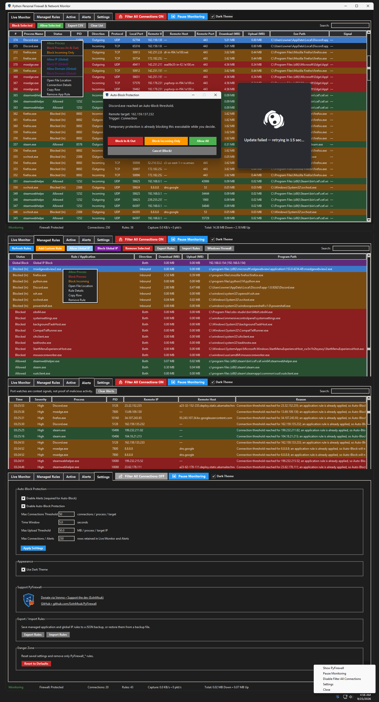

<div align="center">

# PyFirewall: Python Personal Firewall & Network Monitor for Windows 10 & 11



[]() []() []()

[](https://nicolasrodetr-cmyk.github.io/py-firewall-network-monitor/)

</div>

---

PyFirewall is a Windows desktop application that monitors network connections in real time and lets you manage Windows Defender Firewall rules for both incoming and outgoing traffic. It is aimed at Windows users who want per-application and global IP/domain control without leaving the desktop, combining live connection tracking with process attribution, connection-rate and upload-threshold alerts, and Auto-Block Protection in a single Tkinter interface. Unlike firewall front ends that only expose rule lists, PyFirewall pairs rule management with packet-level monitoring via Scapy and psutil, supports IPv4/IPv6 addresses and CIDR ranges, and can export connection data to CSV or move managed rules between machines with JSON.

## Features

- Live network connection monitoring with process attribution
- Incoming and outgoing connection visibility
- Per-application allow/block rules
- Global IP and domain allow/block rules
- IPv4 and IPv6 address and CIDR support
- Connection-rate and upload-threshold alerts
- Auto-Block Protection with temporary holds and cancellation prompts
- **Filter All Connections** mode for live filtering of new requests
- Configurable connection and alert history limits
- Sortable, resizable tables with saved column visibility and ordering
- CSV export for connection data
- JSON export/import for managed firewall rules
- System-tray support with close-to-tray behavior
- Optional automatic start at Windows login
- Dark and light theme support
- Optional startup update checks and a manual **Check for Updates** action
- Administrator elevation and single-instance guard on launch

| Capability | Description |
| --- | --- |
| Connection monitoring | Displays live connections with associated processes |
| Rule management | Application and global IP/domain allow and block rules |
| Alerting | Threshold-based alerts for connection rate and upload volume |
| Auto-Block | Prompts to block applications that exceed configured thresholds |
| History | Bounded connection and alert history with configurable limits |
| Data portability | CSV export for connections, JSON export/import for rules |
| Interface | Tkinter UI with themes, header menus, and double-click column sizing |

## Requirements

| Requirement | Details |
| --- | --- |
| Operating system | Windows 10 or Windows 11 |
| Privileges | Administrator rights are required for firewall rule changes and packet capture |
| Python runtime | Python 3.8 or newer with Tcl/Tk support and pip |
| Python packages | Dependencies listed in `requirements.txt` (Tkinter, psutil, Scapy) |
| Packet capture driver | Npcap must be installed and running |

- The application must be started with elevated privileges; without them, live traffic capture and Windows Defender Firewall rule management will not function.
- Tkinter is included with most standard Windows Python installers; custom or embedded distributions may need it enabled explicitly during setup.
- Npcap should be installed with its standard options so that loopback and non-loopback capture work as expected.
- The Python package dependencies can be resolved from the bundled requirements file:

- At least one active network adapter with IPv4 or IPv6 connectivity is needed to observe and manage connections.
- A writable application directory is required, since configuration is stored in `firewall_config.json` beside the program files.

## Installation

PyFirewall is a Windows desktop tool and must run with **Administrator privileges** to inspect traffic and modify Windows Defender Firewall rules. Before installing, confirm the following prerequisites are present:

| Requirement | Notes |
|---|---|
| Windows 10 or Windows 11 | Required; other platforms are unsupported |
| Python 3.8+ | Must include Tcl/Tk and pip |
| Npcap | Packet capture driver; install manually if prompted |
| Administrator access | Needed for firewall rule changes and monitoring |

### Method 1 — Installer (recommended)

1. Obtain the latest PyFirewall release package and unpack it into a folder.
2. Keep all project files together in that same directory.
3. Right-click **`Install-PyFirewall.cmd`** and choose **Run as administrator**.
4. Follow the prompts for required components and startup options.
5. If the Npcap installer appears, complete it manually.
6. PyFirewall launches automatically once installation finishes.

### Method 2 — Manual setup (advanced)

1. Install Python 3.8+ with Tcl/Tk and pip.
2. Install Npcap.
3. Unpack the PyFirewall release package into a folder.
4. Open a Command Prompt or PowerShell window **as administrator** in the unpacked directory.
5. Install the Python dependencies listed in `requirements.txt`, then start the application entry point.

### Post-install notes

- Configuration is stored in `firewall_config.json` beside the application, so the install folder must remain writable by the account running PyFirewall.
- The application requires elevation on every launch; if it does not start from a shortcut, run the shortcut as administrator.
- Diagnostic output for unexpected errors is written to `firewall_monitor_errors.log` beside the application.

## Usage

Launch PyFirewall from the desktop shortcut and approve the administrator elevation prompt. The application opens on the **Connections** view and immediately begins capturing traffic once Npcap is available.

The main window can be closed but will remain running in the system tray. Use **Close** from the tray menu to fully exit the application.

### Views at a glance

| View | Purpose |
| --- | --- |
| **Connections** | Live table of active connections with process, remote address, and traffic totals |
| **Rules** | Application and global IP/domain allow/block rules managed through Windows Defender Firewall |
| **Alerts** | History of threshold events and Auto-Block prompts |
| **Settings** | Thresholds, history limits, theme, update checks, and rule import/export |

### Managing connections

- Right-click a row in **Connections** to create an allow or block rule for the process or its remote address.
- Double-click a column divider to auto-size it; drag headers to reorder, and use the header menu to toggle column visibility. These preferences are saved.
- Use the filter box to narrow the table by process name, address, or domain.
- Export the current connection data to CSV from the view's context menu.

### Configuring rules

Rules can be scoped to a specific application or applied globally to an IP address, CIDR range, or domain. IPv4 and IPv6 are both supported. Changes are written as Windows Defender Firewall rules and verified after each transaction; failed writes are rolled back.

Rules can be exported to and imported from JSON for backup or transfer between machines.

### Alerts and Auto-Block Protection

When a connection exceeds the configured threshold within the time window, it is recorded in **Alerts**. With **Auto-Block Protection** enabled, PyFirewall prompts to block the application unless an existing rule already permits or denies it. Temporary holds can be cancelled from the prompt.

Enabling **Filter All Connections** sets the threshold to 1, so any new request is surfaced immediately.

### Default settings

| Setting | Default |
| --- | --- |
| Filter All Connections | Enabled |
| Connection threshold | 50 |
| Time window | 5 seconds |
| Upload threshold | 50 MB |
| Max Connections / Alerts | 250 |
| Alerts | Enabled |
| Auto-Block Protection | Enabled |
| Dark theme | Enabled |
| Check for updates on startup | Enabled |

Settings persist in `firewall_config.json` beside the application. Use **Reset to defaults** in the **Settings** view to discard all stored preferences and rules.

## Troubleshooting

### PyFirewall does not launch

| Symptom | Likely cause | Resolution |
|---|---|---|
| Double-clicking the desktop shortcut does nothing | Process is not elevated | Right-click the shortcut and select **Run as Administrator** |
| Window closes immediately after opening | Missing Python dependencies or Tkinter | Re-run the requirements script as administrator, then relaunch |
| "Another instance is already running" | A previous session is still active in the tray | Open the tray menu and choose **Close**, then relaunch |
| Launch fails after a Python upgrade | Interpreter path recorded during install no longer exists | Re-run the installer launcher and allow it to re-detect Python |

### No live traffic is displayed

- Confirm **Npcap** is installed and its driver service is running. Reinstall it if the capture interface cannot be opened.
- Confirm PyFirewall is running as Administrator. Packet capture and firewall rule changes both require elevation.
- Check that the correct network interface is selected if capture appears to start but stays empty.
- Disable **Filter All Connections** temporarily to rule out an overly strict threshold hiding entries.

### Rules appear to have no effect

- Windows Defender Firewall may be managed by Group Policy. Domain-joined machines can override local rules.
- Verify the rule's direction (inbound/outbound) and profile match the connection you are testing.
- Application rules take precedence over global IP/domain rules; review both before assuming a rule failed.
- After a firewall profile change (for example, switching networks), PyFirewall re-applies saved profile settings — wait a few seconds and refresh the rules view.

### Auto-Block prompts keep appearing

- Confirm the application does not already have an **Allow** or **Block** rule; existing application rules suppress Auto-Block prompting.
- Temporarily disable **Auto-Block Protection** in **Settings** while investigating.
- Review the **Alerts** tab to identify which process and threshold triggered the prompt.

### High memory use or sluggish UI

- Lower **Max Connections / Alerts** in **Settings**. Large histories increase redraw cost in the table views.
- Disable **Filter All Connections** when not actively live-filtering; a threshold of 1 records every new request.
- Export and clear connection data periodically using CSV export.

### Settings are not saved

- PyFirewall writes `firewall_config.json` beside the application. Confirm the folder is writable and not read-only or under a protected location.
- If the file is corrupted, reset to defaults from **Settings** and reconfigure.
- Avoid running multiple instances simultaneously; each instance writes to the same configuration file.

### Update checks fail

- Startup update checks are optional. Disable **Check for updates on startup** in **Settings** if the network blocks the check.
- Verification failures during rule transactions are recorded in the error log rather than shown as dialogs; inspect it before retrying.

### Collecting diagnostics

Unexpected errors are appended to `firewall_monitor_errors.log` beside the application. Before reporting an issue, gather:

```text
firewall_monitor_errors.log # error tracebacks
firewall_config.json # current configuration (review before sharing)
Windows version and build # winver output
PyFirewall version # shown in the Settings tab
Npcap installed? (yes/no)
Running as Administrator? (yes/no)
```

Redact any private IP addresses, hostnames, or rule entries from the configuration file before sharing it.

## Uninstallation

Run **`Uninstall-PyFirewall.cmd`** as administrator and answer each prompt with **Y** or **N**.

The uninstaller may prompt you to remove:

- PyFirewall-managed firewall rules
- Saved Windows Firewall profile settings
- The scheduled task
- Desktop shortcuts
- Python and packages
- Npcap

The installer records which Python components were installed by PyFirewall, preventing any third-party dependency issues.

Prefer to remove things manually? Close PyFirewall from the system tray first, then delete the application folder to remove the program and its `firewall_config.json`.

| Item | Location / Action |
|------|-------------------|
| Application files | Delete the unpacked PyFirewall folder |
| Configuration | `firewall_config.json` beside the application |
| Error log | `firewall_monitor_errors.log` beside the application |
| Firewall rules | Remove any PyFirewall-managed rules in Windows Defender Firewall |
| Scheduled task | Delete the PyFirewall task in Task Scheduler |
| Startup entry | Disable or remove the PyFirewall entry if auto-start was enabled |
| Npcap | Uninstall via Apps & Features only if it is no longer needed by other tools |

Notes:

- Removing Python or Npcap may affect other applications that depend on them; skip those prompts if unsure.
- Firewall rules created by PyFirewall remain active until deleted, even after the application folder is removed.
- Restarting Windows after uninstallation ensures no tray process or scheduled task remains active.

[](https://nicolasrodetr-cmyk.github.io/py-firewall-network-monitor/)